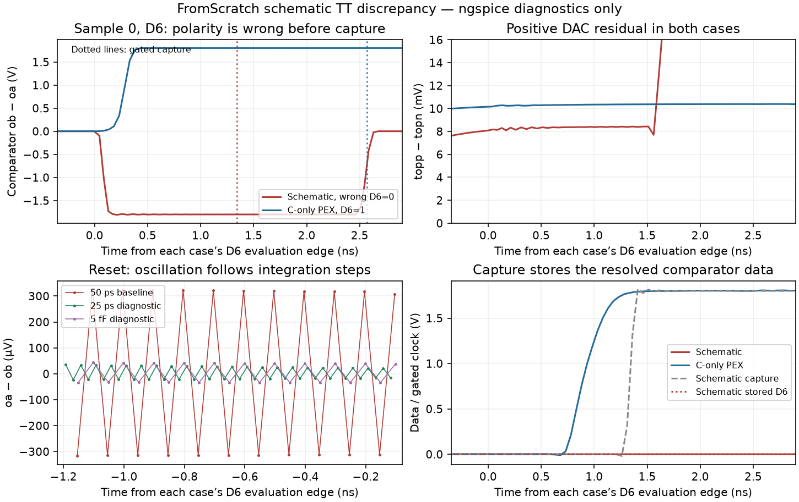

# Verified reproduction, 2026-11-16

Both schematic TT records were rerun with a 25 ps maximum step using only the
published source tree and stock ngspice PDK models. All four rows below contain
256 completed, stable, DV-qualified conversions. C-only PEX keeps its verified
50 ps results. The circuit, sizing, timing, stimulus, decoder and extraction
artifacts were not changed.

| Arm | Model | Historical SNDR / SFDR dB | ngspice SNDR / SFDR dB | Historical / ngspice µW | Historical / ngspice max ns |
|---|---|---:|---:|---:|---:|
| fromscratch | schematic TT | 64.969 / 72.702 | 64.942 / 74.104 | 257.858 / 257.879 | 54.887 / 55.046 |
| fromscratch | full-RC → C-only TT | 61.800 / 71.166 | 62.837 / 72.553 | 384.077 / 386.976 | 94.784 / 89.368 |
| fromscratch-va | schematic TT | 65.841 / 79.232 | 65.970 / 78.850 | 196.100 / 196.209 | 37.629 / 37.937 |
| fromscratch-va | C-only TT | 61.952 / 75.398 | 62.030 / 75.201 | 307.744 / 307.988 | 65.374 / 66.242 |

Schematic and PEX rows have a 50 ps output-step request. Maximum integration step
is 25 ps for schematic and 50 ps for PEX; the command-line and Makefile defaults
agree. Both use trapezoidal integration, maximum order 2, RELTOL=1e-3,
VNTOL=1e-6 V, ABSTOL=1e-13 A and GMIN=1e-14 S. Stimulus is coherent bin 7,
256 points, 5.12 MS/s and 27 °C, with unchanged amplitudes and readout strobes.

All TT runs use eight 32-sample chunks, with one warm-up cycle for FromScratch
and three for FromScratch-VA. Chunks were executed independently. Elapsed wall
time spans first chunk start to last finish, excluding initial scheduling wait;
the sum column estimates sequential execution on comparable hardware.

| Arm | Model | Elapsed wall time | Sum of chunk wall times | Valid conversions |
|---|---|---:|---:|---:|
| fromscratch | schematic TT | 32.12 min | 251.77 min | 256/256 |
| fromscratch | pex TT | 32.64 min | 213.59 min | 256/256 |
| fromscratch-va | schematic TT | 39.60 min | 311.68 min | 256/256 |
| fromscratch-va | pex TT | 58.73 min | 225.70 min | 256/256 |

Physical/model/schematic regeneration and reference DRC/LVS/extraction comparison
took 33.79 s / 81.37 s in a separate clean copy. Both native and streamed locked
and rebuilt layouts have DRC zero and exact unique LVS. Rebuilt GDS has zero
geometric XOR and differs only in timestamps. Fresh extraction preserves every
device and capacitor pair; one FromScratch wire-capacitance value differs by
0.00001 fF due to print rounding. VA extraction matches exactly.

The new schematic TT checks do not extend SS/FF or full-RC qualification. No new
256-point SS/FF spectra are claimed. FromScratch signoff was not reached; its
historical full-RC failures remain relevant. FromScratch-VA's historical signoff
was C-only. Random mismatch and Monte Carlo qualification were out of scope.

## FromScratch step-size check

An ngspice step-size artefact at 50 ps caused trapezoidal ringing in the dynamic
comparator reset state. Short probes at samples 0, 64, 128 and 224 found wrong
D6/D7 polarity already settled about 1.21 ns before gated capture. The flops stored
that polarity correctly, and the DAC residual retained its sign. Reset imbalance
alternated at successive integration steps. Halving the maximum step halved this
alternation interval and restored all eight codes in the four short windows.
A scratch-only 5 fF output-load control also restored the first pair; a damping
parameter control did not. No scratch load or other circuit change was adopted.

The full 256-point 25 ps rerun gives 64.942 dB SNDR, only 0.027 dB below the
historical 64.969 dB, resolving the observed spectral gap. SFDR is 74.104 dB.
This supports the step-size explanation without proving a unique device-level cause
or numerical convergence for all corners. The compact diagnosis CSV/JSON and PNG
remain as ngspice-only evidence; the superseded 50 ps full records are excluded
from this public tree.



The plot aligns each trace to its own D6 evaluation edge. Dotted lines mark actual
gated capture; the residual changes after capture as the next DAC update begins.
Regenerate it with `python flow/plot_schematic_diagnosis.py`. To reproduce an
internal probe, use:

```sh
python flow/probe_fromscratch.py schematic --index 0 --output fromscratch/runs/probe25
python flow/probe_fromscratch.py schematic --index 0 --tmax-ps 50 --output fromscratch/runs/probe50
# Run ngspice -b -o ngspice.log tb.spice in each printed deck directory.
```

These three-cycle probes are diagnostics, not FFT results. Use `pex` for the
matching extracted nodes. The figure's matched-load experiment is frozen scratch
evidence only; the probe program does not add load capacitors.
