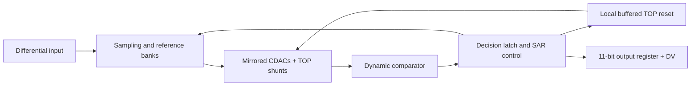
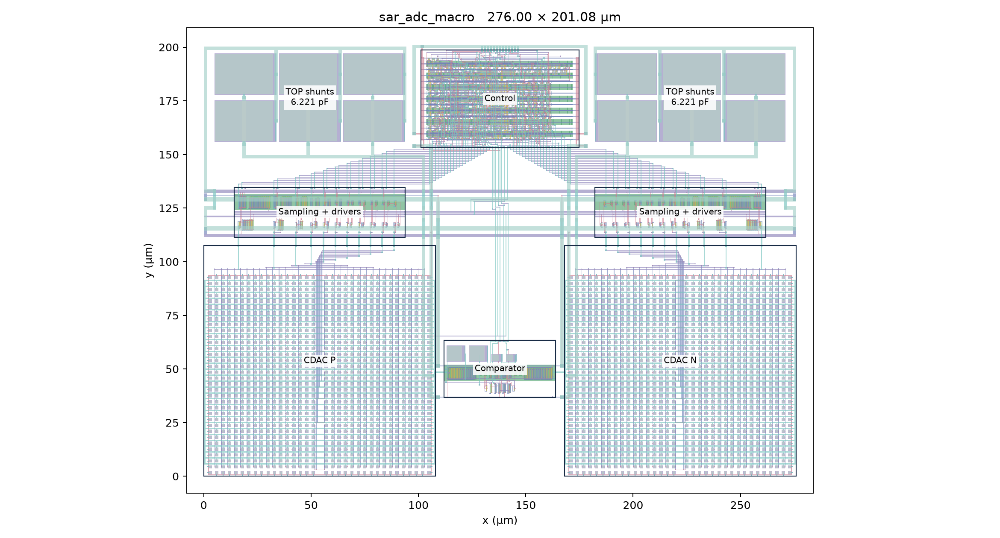

# FromScratch-VA: locked reset-buffer and top-shunt design

LLM design agents produced this design from scratch, without a reference design.
They received the shared specification and the functional-model/block-test and
floorplan/block-extraction instructions in `protocol/`. The circuit is an 11-bit
differential asynchronous monotonic SAR using bottom-plate sampling and a dynamic
comparator. CLK high tracks; the falling phase starts conversion. D10 is MSB and
DV marks completion. Input common mode is 0.95 V, declared full scale is 1.8 V
differential peak, and the FFT stimulus is 1.60434 V differential peak.

The macro is 276 × 201.08 µm, or 0.05549808 mm². Symmetric arrays occupy the lower
corners, banks lie above them, the comparator sits between the arrays, and logic
occupies the top center. Matched top-plate shunts fill the spaces beside the logic.

| Block | Locked sizing / implementation |
|---|---|
| CDAC, each side | 1024 active 1.24 × 1.24 µm MIM units, model value 3.87585 fF, plus 132 grounded perimeter units |
| Top shunts, each side | Six 27 × 18.92 µm MIMs to VSS; total 6.2208951 pF |
| Sampling bank | MSB TG N/P 48/96 µm total, scaled by bank weight with 1.5 µm minimum; L=0.15 µm |
| Reference bank | MSB N/P 6/30 µm, scaled by bank weight; selected small-bank N widths 1.8 µm for antenna closure |
| Top reset | 26 × 4.92 µm PMOS fingers, total 127.92 µm per side, L=0.15 µm |
| Local reset driver | Two inverter stages, N/P 4/8 then 8/16 µm |
| Comparator | LVT input pair 8/0.15; tail N 4/0.15; latch N/P 2/3 µm; reset P 1.5 µm |
| Comparator loads | Internal-node MIM 7.07 × 7.07 µm; output MIM 3.16 × 3.16 and 3.23 × 3.23 µm |
| Controller | Standard-cell decision latch, thermometer pointer and output registers; five sd3 settling cells |

## Selected decisions

The functional models separated switch injection, comparator kickback and timing
from the digital sequencer. Integration exposed comparator-output/clock coupling:
a diagnostic removal of only 8.803 fF improved an earlier extracted spectrum from
53.871/67.924 to 64.416/78.708 dB. Grounded guards implement the correction physically.
Wider upper-metal supply trunks reduce rail delay. The final geometry includes both.

Larger buffered reset devices reduced earlier startup excursions but introduced
third-harmonic distortion. Matched linear top-plate MIM loads improved schematic
SFDR from 63.984 to 79.232 dB. The selected six-device geometry fits the same outline.
It increases reference energy and reduces comparator input gain; neither cost is
removed from the reported circuit. These are design-time one-change experiments,
not new ngspice measurements. The final design has no added clock qualifier or
input meander.

## Qualification limits

The public 25 ps schematic TT run gives 65.970/78.850 dB SNDR/SFDR and
196.209 µW using the unchanged circuit, timing, stimulus and decoder.
See [VALIDATION.md](../VALIDATION.md) for numerical settings and full-record checks.

Original schematic TT: 65.841/79.232 dB SNDR/SFDR, 196.100 µW and 37.629 ns maximum
conversion. Original C-only PEX TT: 61.952/75.398 dB, 307.744 µW and 65.374 ns.
Original SS and FF C-only spectra were 60.139/73.520 and 63.255/74.132 dB, with
93.721 and 49.709 ns maximum conversion; all 256 conversions completed per corner.
Power includes analog, digital and reference energy. The TT FoM of 58.749 fJ/step
exceeds the approximate 50 fJ expectation, which was not a hard target.

**Signoff here means the original C-only scope.** A complete full-RC FFT was not
obtained. Finite reference/ground resistance, spatial wire-capacitance placement
and extraction approximations remain relevant. Measured TOP/reset excursions of
2.104 V and delay-cell internal excursions around 2.064 V exceeded the cited 1.95 V
DC model range; this is an open voltage-qualification issue. Startup sequencing,
source/load tolerance, transistor-level dense static linearity, thermal noise,
systematic gradients, chip fill/density, EM, pads and package effects remain unqualified.
Random mismatch and Monte Carlo qualification were out of scope.
