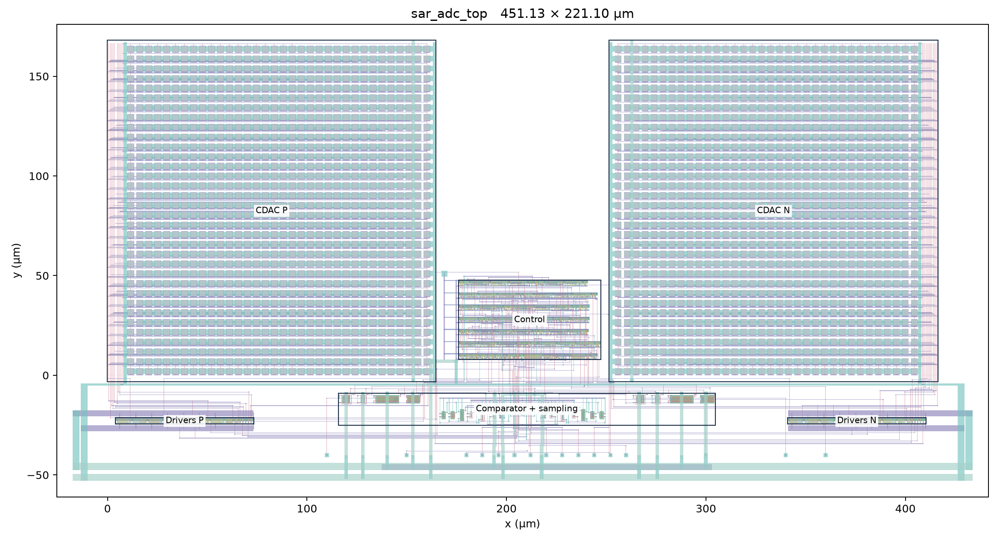
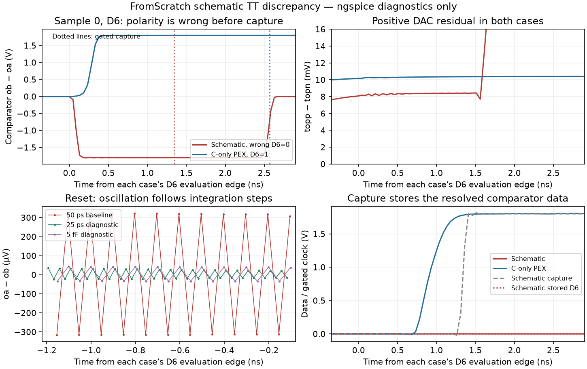

# FromScratch: locked C20G design

LLM design agents produced this ADC from the specification without a reference design.
It is an 11-bit differential asynchronous monotonic SAR with top-plate input sampling.
CLK high tracks the input; its falling phase starts conversion. Eleven raw decisions
and DV are exported. The period is 195.3125 ns; conversion must finish within its
97.65625 ns second half. Supplies and references are ideal outside the macro.
VREFP is a separate macro pin; the low reference is VSS.




The bounding box is 451.13 × 221.10 µm, or 0.099744843 mm². Mirrored capacitor arrays
occupy the sides, the controller occupies the central gap, and the comparator,
sampling switches and reference drivers sit below the arrays. The top-plate wiring,
grounded comparator shield and local supply paths are part of the published geometry.

| Block | Locked sizing / implementation |
|---|---|
| CDAC, each side | 1024 active unit MIMs, including one grounded dummy; 132 grounded perimeter units; 3 × 3 µm unit geometry, model value 19.96225 fF |
| Input TG, each side | Total N/P width 32/32 µm; N LVT L=0.15 µm, P LVT L=0.35 µm; 8/16 drawn fingers |
| Sampling dummies | Half-width shorted-terminal switches, matched device type; preserved placement frame |
| Dynamic comparator | Tail N 4/0.15; input N 5/0.15; latch N 2/0.15 and P 4/0.15; reset P 2/0.15 µm |
| Decision detectors | One active input of each NOR3 on the analog supply; other inputs grounded |
| Controller | Standard-cell token chain, decision flops and output buffers; two capture, three reset and two clock-delay sd3 cells |
| Reference drivers | Standard inverters powered from VREFP; largest bank uses four inv_16 cells in parallel, then binary-scaled stages |

The frozen parameter file is `scripts/p_M3.json`. Generator output preserves device
width, length, finger geometry, junction parameters, clocking and connectivity.
The local detector connection limits dynamic-latch loading. Matched dummy switches
address charge injection. Routing and supply changes in the selected physical build
reduce differential imbalance without changing the top-level interface.

## Output interpretation

Schematic results use ordinary binary decoding. Physical results also retain that
spectrum, but the selected interface uses a fixed fractional reconstruction of the
eleven raw decisions. The coefficients in `schematic/C20G_RECONSTRUCTION.json` depend
only on the physical MIM and extracted top-to-bank capacitances:

```text
q = 1023.5 + normalization × sum((2×D_i − 1) × weight_i), i = 0..10
```

D10 is the first sign decision and D0 the final decision. The normalization is
1.0133136735989607. D0 has weight 0.5; the other weights follow the bank capacitance
ratios. One frozen coefficient set applies to all physical corners. No tone, code
fit, per-corner weights or per-sample correction is used. It was adopted after the
raw spectra were already known, so it is not a blind pre-spectrum calibration.
Integer rounding is an additional operation and was not qualified. The decoder is
external to the macro: its implementation cost is excluded from area and supply power.

## Qualification limits

The locked original schematic TT result was 64.969/72.702 dB SNDR/SFDR and 257.858 µW.
The original full-RC TT result was 61.800/71.166 dB with fractional reconstruction,
384.077 µW and 94.784 ns maximum conversion. Its binary result was 59.895/70.532 dB;
rounded reconstruction also failed. SS had zero completed conversions in the required
window. FF gave 56.924/68.293 dB with the fractional decoder and failed.
**This is a deadline baseline, not an all-corner qualified ADC.**

## Known issues

An ngspice step-size artefact at 50 ps caused trapezoidal ringing in the dynamic
comparator during reset and wrong mid-bit decisions before capture. A 25 ps
maximum step resolves the spectral gap in the full 256-point schematic TT record;
it is now the default. The circuit, sizing, timing, stimulus and decoder are
unchanged. The diagnostic plot retains short 50 ps failure windows and step/load
controls; those controls are not modifications to the published design.

The new schematic TT result is 64.942/74.104 dB SNDR/SFDR and 257.879 µW,
compared with historical 64.969/72.702 dB and 257.858 µW. The observed TT step-size artefact is resolved. All-corner numerical convergence
and physical qualification remain open. See [VALIDATION.md](../VALIDATION.md#fromscratch-step-size-check).



The public ngspice flow uses C-only PEX. It omits finite wire and rail resistance,
including the effects that made the historical SS conversion overrun. C-only results
must not replace the original full-RC qualification. Full-RC reproduction, antenna
closure, chip-context density/fill, loaded-output and source-impedance tolerance,
startup, model voltage-range checks and static INL/DNL remain open. Random mismatch
and Monte Carlo qualification were out of scope; the target FFT is noiseless.
